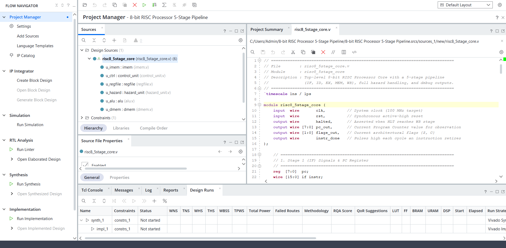
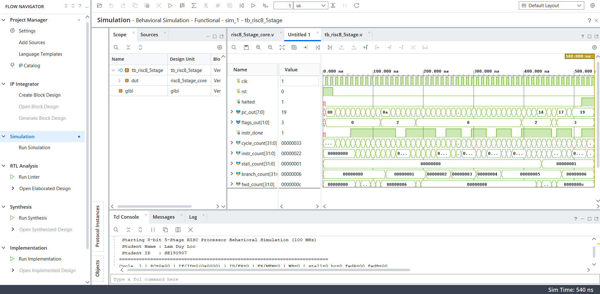
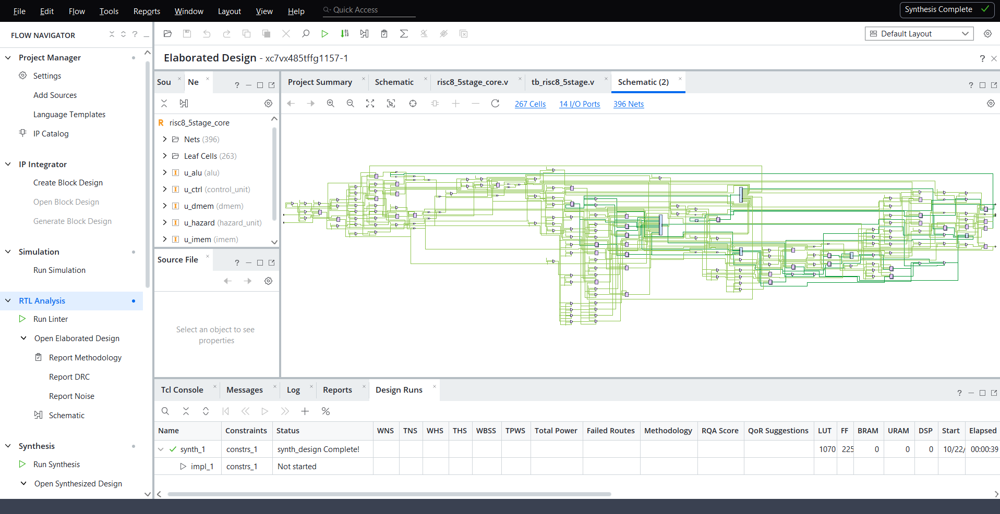
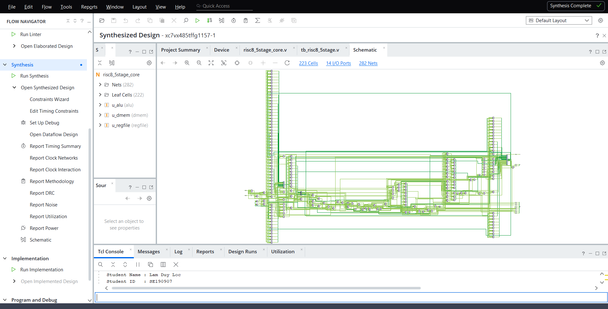
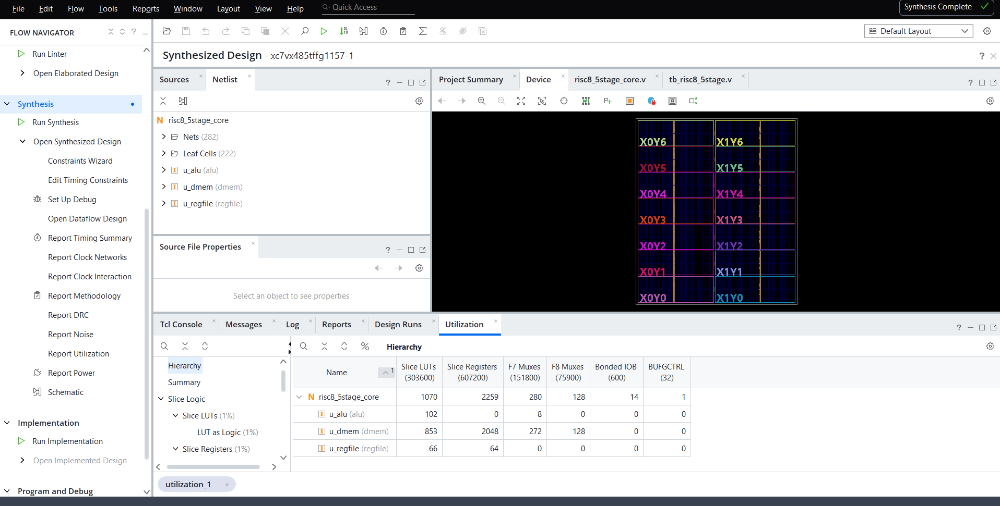

# 8-Bit 5-Stage Pipelined RISC Processor (Verilog & Vivado)

**Author:** Lam Duy Loc  
**Student ID:** SE190907  
**Tools & Language:** Verilog-2001 (RTL), AMD Xilinx Vivado  
**Target FPGA:** Xilinx Virtex-7 (`xc7vx485tffg1157-1`) — Target Clock: 100 MHz (10 ns)

---

## 1. Project Overview

This project implements a complete **8-bit RISC processor core** featuring a classic **5-stage pipeline** (`IF`, `ID`, `EX`, `MEM`, `WB`) written from scratch in synthesizable Verilog-2001. The processor uses a **Harvard architecture** with separate instruction and data memories, a hard-wired combinational control unit, an 8-operation Arithmetic Logic Unit (ALU), an $8 \times 8$-bit register file with internal write-through bypass, and a dedicated Hazard Unit.

All data and control hazards are resolved automatically in hardware via operand forwarding, a 1-cycle load-use stall, and a 2-cycle branch flush. The processor is verified using a self-checking testbench that passes 9 out of 9 architectural checks and is synthesized for a Xilinx Virtex-7 FPGA in Vivado.

---

## 2. Core Specifications

| Parameter | Specification | Description |
| :--- | :--- | :--- |
| **Data Width** | 8 bits | Registers, ALU, and data memory operate on 8-bit numbers ($0$ to $255$). |
| **Instruction Width** | 16 bits (fixed) | Every instruction is encoded as a single 16-bit word for simple decoding. |
| **Register File** | $8 \times 8$-bit (`R0`–`R7`) | Two asynchronous read ports, one synchronous write port with write-through bypass; `R0` is a regular general-purpose register. |
| **Program Counter (PC)** | 8 bits | Addresses up to 256 instructions ($0\text{x}00$ to $0\text{xFF}$). |
| **Memory Architecture** | Harvard | Separate Instruction Memory ($256 \times 16$-bit ROM) and Data Memory ($256 \times 8$-bit RAM). |
| **Pipeline Stages** | 5 stages | `IF` (Fetch) $\rightarrow$ `ID` (Decode) $\rightarrow$ `EX` (Execute) $\rightarrow$ `MEM` (Memory) $\rightarrow$ `WB` (Write-Back). |
| **Status Flags** | `Z` (Zero), `C` (Carry/Borrow) | Updated in the `EX` stage by arithmetic, logic, and shift instructions. |
| **Instruction Set (ISA)** | 16 instructions (4-bit opcode) | Arithmetic, bitwise logic, shifts, immediate, load/store, jump/branch, NOP, and halt. |
| **Hazard Resolution** | Hardware-managed | Data forwarding, register-file bypass, 1-cycle load-use stall, and 2-cycle branch flush. |
| **Target Clock** | 100 MHz | 10 ns clock period defined in `risc8.xdc`. |

---

## 3. Repository Structure

    LamDuyLoc_SE190907_8-Bit_RISC/
    ├── constrs/
    │   └── risc8.xdc                                       # 100 MHz (10 ns) clock constraint for Vivado
    ├── sources/
    │   ├── alu.v                                           # Stage 3 (EX): 8-bit ALU and Z/C flag generation
    │   ├── control_unit.v                                  # Stage 2 (ID): Hard-wired opcode decoder
    │   ├── dmem.v                                          # Stage 4 (MEM): 256 x 8-bit Data Memory (RAM)
    │   ├── hazard_unit.v                                   # Forwarding mux control and load-use stall detector
    │   ├── imem.v                                          # Stage 1 (IF): 256 x 16-bit Instruction Memory (ROM)
    │   ├── regfile.v                                       # Stage 2/5 (ID/WB): 8 x 8-bit Register File with bypass
    │   └── risc8_5stage_core.v                             # Top-level 5-stage pipelined processor core
    ├── sim/
    │   └── tb_risc8_5stage.v                               # Self-checking testbench with cycle-by-cycle logging
    └── Screenshots/
        ├── F1_Project_Sources/Project_Sources.png          # Vivado project hierarchy and source files
        ├── F2_Waveform/waveform.png                        # Full behavioral simulation waveform (0 to 540 ns)
        ├── F3_Tcl_Console/Tcl_Console.png                  # Self-checking verification log in Tcl Console
        ├── F4_Elaborated_Schematic/Schematic.png           # RTL Elaborated Design schematic
        ├── F5_Synthesized_Schematic/Synthesized_Design.png # Gate-level Synthesized Design schematic
        ├── F6_Report_Utilization/Report_Utilization.png    # Virtex-7 FPGA resource utilization report
        └── Truth_Table/                                    # Control unit truth table documentation

---

## 4. Instruction Set Architecture (ISA)

Every instruction is 16 bits wide. Bits `[15:12]` always hold the 4-bit `opcode`, while the remaining bits follow one of four clean formats:

* **R-type:** `opcode [15:12]` | `rd [11:9]` | `rs1 [8:6]` | `rs2 [5:3]` | `000 [2:0]` (`ADD`, `SUB`, `AND`, `OR`, `XOR`)
* **R1-type:** `opcode [15:12]` | `rd [11:9]` | `rs1 [8:6]` | `000000 [5:0]` (`SHL`, `SHR`, `LD`, `ST`)
* **I-type:** `opcode [15:12]` | `rd [11:9]` | `0 [8]` | `imm8 [7:0]` (`LDI`, `ADDI`)
* **J-type:** `opcode [15:12]` | `0000 [11:8]` | `addr8 [7:0]` (`JMP`, `BZ`, `BNZ`)

### Complete Instruction Table (16 Opcodes)

| Opcode (Hex) | Mnemonic | Operation | Flags Affected | Format |
| :---: | :--- | :--- | :---: | :---: |
| `0x0` | `NOP` | No operation | None | - |
| `0x1` | `ADD rd, rs1, rs2` | $rd = rs1 + rs2$ | `Z`, `C` | R |
| `0x2` | `SUB rd, rs1, rs2` | $rd = rs1 - rs2$ | `Z`, `C` (borrow) | R |
| `0x3` | `AND rd, rs1, rs2` | $rd = rs1 \text{ AND } rs2$ | `Z` | R |
| `0x4` | `OR rd, rs1, rs2` | $rd = rs1 \text{ OR } rs2$ | `Z` | R |
| `0x5` | `XOR rd, rs1, rs2` | $rd = rs1 \text{ XOR } rs2$ | `Z` | R |
| `0x6` | `SHL rd, rs1` | $rd = rs1 \ll 1$ ($C = \text{old bit } 7$) | `Z`, `C` | R1 |
| `0x7` | `SHR rd, rs1` | $rd = rs1 \gg 1$ ($C = \text{old bit } 0$) | `Z`, `C` | R1 |
| `0x8` | `LDI rd, imm8` | $rd = imm8$ | None | I |
| `0x9` | `ADDI rd, imm8` | $rd = rd + imm8$ | `Z`, `C` | I |
| `0xA` | `LD rd, [rs1]` | $rd = \text{DataMem}[rs1]$ | None | R1 |
| `0xB` | `ST rd, [rs1]` | $\text{DataMem}[rs1] = rd$ | None | R1 |
| `0xC` | `JMP addr8` | $PC = addr8$ | None | J |
| `0xD` | `BZ addr8` | If $Z == 1$, then $PC = addr8$ | None | J |
| `0xE` | `BNZ addr8` | If $Z == 0$, then $PC = addr8$ | None | J |
| `0xF` | `HLT` | Stop processor execution | None | - |

---

## 5. Five-Stage Pipeline & Hazard Handling

### 5.1. Pipeline Stages and Inter-Stage Registers
1. **Stage 1 — IF (Instruction Fetch):** Reads the 16-bit instruction from `imem` at address `PC` and computes the next `PC` with strict priority: Taken Branch $\rightarrow$ Halt in pipeline $\rightarrow$ Load-use Stall $\rightarrow$ Sequential ($PC + 1$).
2. **Stage 2 — ID (Instruction Decode):** Extracts instruction fields, generates control signals in `control_unit`, and reads operands from `regfile` (with special read redirection: `ADDI` reads `rd` on Port A, and `ST` reads `rd` on Port B).
3. **Stage 3 — EX (Execute):** Selects forwarded operands, performs arithmetic/logic operations in `alu`, updates architectural `Z` and `C` flags, and resolves `JMP`, `BZ`, and `BNZ` branches.
4. **Stage 4 — MEM (Memory Access):** Reads data asynchronously from `dmem` for `LD` or writes data synchronously on the rising clock edge for `ST`.
5. **Stage 5 — WB (Write-Back):** Writes the final result (from either `dmem` or `alu`) back into destination register `rd` in `regfile`.

Four pipeline registers separate the stages: `IF/ID` (17 bits), `ID/EX` (48 bits), `EX/MEM` (32 bits), and `MEM/WB` (14 bits). Each stage carries a `valid` bit so empty slots (bubbles, `valid = 0`) and flushed instructions never modify registers, memory, or flags.

### 5.2. Control Unit Truth Table

| Instruction | `alu_op` | `alu_src_imm` | `uses_a` | `uses_b` | `reg_we` | `mem_to_reg` | `mem_we` | `flag_we` | Branch / Halt |
| :--- | :---: | :---: | :---: | :---: | :---: | :---: | :---: | :---: | :---: |
| `ADD` / `SUB` / `AND` / `OR` / `XOR` | `000`–`100` | `0` | `1` | `1` | `1` | `0` | `0` | `1` | `0` |
| `SHL` / `SHR` | `101` / `110` | `0` | `1` | `0` | `1` | `0` | `0` | `1` | `0` |
| `LDI` | `111` | `1` | `0` | `0` | `1` | `0` | `0` | `0` | `0` |
| `ADDI` | `000` | `1` | `1` | `0` | `1` | `0` | `0` | `1` | `0` |
| `LD` | `000` | `0` | `1` | `0` | `1` | `1` | `0` | `0` | `0` |
| `ST` | `000` | `0` | `1` | `1` | `0` | `0` | `1` | `0` | `0` |
| `JMP` / `BZ` / `BNZ` | `000` | `0` | `0` | `0` | `0` | `0` | `0` | `0` | `jump` / `br_z` / `br_nz` |
| `HLT` / `NOP` | `000` | `0` | `0` | `0` | `0` | `0` | `0` | `0` | `halt` (for `HLT`) |

### 5.3. Hardware Hazard Resolution
* **Data Forwarding (0-cycle penalty):** The `hazard_unit` checks whether the instruction in `EX` reads a register (`uses_a` / `uses_b`) that a younger-in-flight instruction in `MEM` or `WB` is about to write. It prioritizes the newest ALU result in `EX/MEM` (`fwd_sel = 01`) over the older result in `MEM/WB` (`fwd_sel = 10`).
* **Register-File Write-Through Bypass (0-cycle penalty):** Resolves distance-3 Read-After-Write (RAW) dependencies when `WB` writes to the same register that `ID` is reading in the same clock cycle.
* **Load-Use Stall (1-cycle penalty):** When `EX` holds a valid `LD` instruction and the instruction in `ID` needs the loaded register immediately, `stall` is asserted for 1 cycle. `PC` and `IF/ID` hold their values while a bubble is inserted into `ID/EX`, allowing the loaded byte to be forwarded from `MEM/WB` on the very next cycle.
* **Control Hazard Branch Flush (2-cycle penalty):** Branches are decided in `EX` using up-to-date flags. When a branch or jump is taken, `PC` is updated to the target address and the two wrong-path instructions in `IF/ID` and `ID/EX` are flushed into bubbles.

---

## 6. Verification Plan & Simulation Results

The built-in verification program in `imem.v` executes 34 instructions across five test phases:
1. **Logic, Shifts & Forwarding (`PC 0x00–0x07`):** Tests `LDI`, `AND`, `OR`, `XOR`, `SHL`, `SHR`, `SUB`, and operand forwarding at distances 1, 2, and 3.
2. **Conditional Branch & Wrong-Path Flush (`PC 0x08–0x09`):** Takes `BZ 0x0A` when $Z = 1$ and flushes a wrong-path `LDI R7, 0xFF` instruction.
3. **Accumulation Loop (`PC 0x0A–0x0F`):** Computes the sum $5 + 4 + 3 + 2 + 1 = 15$ (`0x0F`) in `R2` using `ADD`, `SUB`, and `BNZ`.
4. **Memory Access, Load-Use Stall & Overflow (`PC 0x10–0x14`):** Stores `0x0F` to `Memory[0x20]` (`ST`), loads it back into `R5` (`LD`), triggers a 1-cycle load-use stall on `ADDI R5, 0xF0`, and tests 8-bit carry overflow (`0xFF + 0x01 = 0x00`, setting $Z = 1$ and $C = 1$).
5. **Unconditional Jump & Halt (`PC 0x15–0x17`):** Jumps over a wrong-path instruction via `JMP 0x17` and halts cleanly on `HLT`.

### Automated Self-Checking Results (9 / 9 Checks Passed)

| Check Item | Expected Value | Actual Value | Status |
| :--- | :---: | :---: | :---: |
| Register `R1` (Loop counter final state) | `0x00` | `0x00` | **PASS** |
| Register `R2` (Loop sum $5+4+3+2+1$) | `0x0F` | `0x0F` | **PASS** |
| Register `R3` (Loop decrement step) | `0x01` | `0x01` | **PASS** |
| Register `R4` (Data memory pointer) | `0x20` | `0x20` | **PASS** |
| Register `R5` (`0x0F + 0xF0 + 0x01` overflow) | `0x00` | `0x00` | **PASS** |
| Register `R6` (`0x33 << 1`) | `0x66` | `0x66` | **PASS** |
| Register `R7` (Verifies wrong-path instructions were flushed) | `0x00` | `0x00` | **PASS** |
| Data Memory `Memory[0x20]` | `0x0F` | `0x0F` | **PASS** |
| Architectural Flags `{Z, C}` | `1, 1` | `1, 1` | **PASS** |

### Pipeline Execution Metrics
* **Total Execution Cycles:** 51 cycles (simulation completes at $540\text{ ns}$)
* **Completed Instructions:** 34 instructions
* **Cycles Per Instruction (CPI):** $51 / 34 = 1.50$
* **Load-Use Stalls:** 1 cycle (at Cycle 42)
* **Taken Branches / Jumps:** 6 taken branches (2-cycle flush each)
* **Forwarded Operands:** 12 forwards

### Behavioral Simulation Waveform

### Self-Checking Verification Output in Tcl Console

---

## 7. Synthesis on Xilinx Virtex-7 FPGA

The processor core was elaborated and synthesized in Vivado targeting the **Xilinx Virtex-7 (`xc7vx485tffg1157-1`)** FPGA with a **100 MHz (10 ns)** clock constraint and zero inferred latches.

### Resource Utilization Summary

| Resource Type | Total Core (`risc8_5stage_core`) | `u_alu` | `u_dmem` | `u_regfile` | Available on Virtex-7 | Utilization (%) |
| :--- | :---: | :---: | :---: | :---: | :---: | :---: |
| **Slice LUTs** | 1,070 | 102 | 853 | 66 | 303,600 | $< 1\%$ |
| **Slice Registers (Flip-Flops)** | 2,259 | 0 | 2,048 | 64 | 607,200 | $< 1\%$ |
| **F7 Muxes** | 280 | 8 | 272 | 0 | 151,800 | $< 1\%$ |
| **F8 Muxes** | 128 | 0 | 128 | 0 | 75,900 | $< 1\%$ |
| **Bonded IOB** | 14 | 0 | 0 | 0 | 600 | $2.33\%$ |
| **BUFGCTRL** | 1 | 0 | 0 | 0 | 32 | $3.13\%$ |

*Note:* `u_dmem` uses 853 LUTs and 2,048 Slice Registers ($256 \times 8\text{-bit}$) because the data memory includes a synchronous reset that clears all 256 bytes in a single clock cycle, while `u_alu` uses 0 registers, confirming purely combinational logic without unwanted latches.

### RTL Elaborated Schematic

### Gate-Level Synthesized Schematic

### Vivado Resource Utilization Report

---

## 8. How to Run This Project in Vivado

1. **Create Project:** Open Vivado $\rightarrow$ click **Create Project** $\rightarrow$ select **RTL Project** and choose the target FPGA part (`xc7vx485tffg1157-1` or any 7-Series FPGA).
2. **Add Design Sources:** Click **Add Sources** $\rightarrow$ **Add or create design sources** and select all 7 Verilog files inside `sources/`. Ensure `risc8_5stage_core` is set as the Top Module.
3. **Add Constraints:** Select **Add or create constraints** and add `constrs/risc8.xdc`.
4. **Add Simulation Sources:** Select **Add or create simulation sources**, add `sim/tb_risc8_5stage.v`, and set `tb_risc8_5stage` as the Simulation Top module.
5. **Run Behavioral Simulation:** In the **Flow Navigator**, click **Run Simulation** $\rightarrow$ **Run Behavioral Simulation**. Check the **Tcl Console** for the cycle-by-cycle execution trace and the final `*** ALL TESTS PASSED ***` message.
6. **Run Synthesis:** Click **Run Synthesis** in the **Flow Navigator**, then open **Synthesized Design** $\rightarrow$ **Report Utilization** and **Schematic** to inspect hardware resource usage and gate-level netlists.